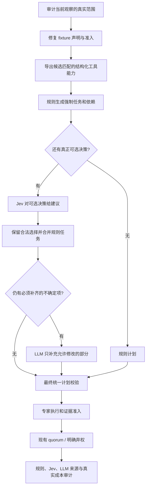

# CV Agent 证明契约修复与 Jev 组合规划实施计划

> **执行方式：** 用户将本计划交给另一智能体实施；当前作者仅制定计划，不实施代码或启动实验。执行者按阶段提交可审查结果，最后由本计划作者复核代码、证据和实验结论。不以安装额外代理技能为执行前提。

**Goal:** 修复“局部事实被当作候选完整证明”的通道，建立保留有效 Jev 决策的组合规划，明确专家适用性与预算行为，用可核对的对照实验检验质量和开销。

**Architecture:** 先统一 fixture 的实际证明范围、候选身份和准入能力声明，再把确定性的强制任务/依赖与模型的可选决策分开。保持既有 E1–E5 作为显式基线；新增版本化的规则规划、Jev V3 和可选专家适用性策略，所有最终判决仍通过原证据准入与仲裁。

**Tech Stack:** Python、Pydantic、LangGraph、pytest、JSON、无参数 Bash launcher。沿用 uv 和 OpenAICompatibleChatModel 的真实调用门禁。

---

## 0. 工作范围、根目录和完成定义

项目根目录是 `/home/joker/AAA_NUS_SEM3/cv_agent`。下文所有仓库相对路径均相对此目录，不能在同名历史 `artifacts/*/source/` 中编辑实现。

本轮交付包含：A 证明范围与准入修复；B 组合规划和来源记录；C 专家适用性的独立策略与离线验证；D 预算/纠正调用审计；E 一次有界三臂实验；F 完整交接包。顺序为 A → B → C/D → E → F。

这不是“保证原 30-cell 全绿”的计划。完成标准是：不再接纳错误范围的证明，已支持的完整正反证明继续有效，路由和实验如实记录，无法覆盖的性质明确保留未知。hp001 的完整竞态利用证明、hp002 的通用授权证明，若当前实现没有覆盖，不准用模式匹配冒充；也不能把该能力缺口写成已解决。

本计划不要求实现通用 Python 解释器，不改 quorum 数量，不自动部署，不扩大到新的真实大矩阵。新的能力扩展或更大实验作为后续独立批次，由最终审核后的任务决定。

## 1. 执行前必须读的材料

1. `AGENTS.md`、`docs/TEST_CONTRACT.md`（C1–C6 和 T01–T16）。
2. `docs/reference/PROJECT_FLOW_AND_DIAGNOSIS.md`。
3. `docs/reference/JEV_ROUTING.md`、`docs/reference/HP003_JEV_ACTIVE_PLAN.md`。
4. `src/cv_agent/evaluation/datasets/advisory_fixtures.py`。
5. `src/cv_agent/agents/evidence_policy.py`、`planning.py`、`routing.py`、`workflow.py`。

现有工作树有大量用户未提交修改及未跟踪文件。先保存起始补丁、未跟踪文件清单和源码/测试/配置快照；不能用 `git reset`、从 HEAD 重新生成文件或 `git add -A` 覆盖/混入已有工作。若隔离执行，必须携带当前脏工作树的实现，不能只从旧 HEAD 开始。按独立阶段保留增量补丁；不要求替用户提交或推送。

已知记录：

| 记录 | 事实 | 用途 |
| --- | --- | --- |
| `artifacts/python_heldout_pair_matrix_v4/9f59cdbd664b48fdb03175159c5fe4fb` | 29/30 正确、hp001_a/E5 弃权、283 请求、2,008,214 tokens；30 项均使用 fixture；没有 Jev | 本轮修改前的诊断基线 |
| `artifacts/python_heldout_pair_matrix_v4/fixture_all_pairs_full_after_prompt_2026_09_27` | 30/30 正确、292 请求、2,084,142 tokens；不同源码/subject 前提 | 历史参照，不是同版本受控基线 |
| `artifacts/jev_routing_pilot/6b16f651a0904ca194f1af29c86b7366` | Jev 两次成功，scan 概率 0.94/0.95；taint 0.51；全部 applied=false；两组均正确但 Jev 组请求更多 | V3 回归场景 |
| `artifacts/jev_routing_pilot/a2e6a57f88794517ad82ff190535577d` | 4096 源码读取被截断，Jev 零请求 | 已定位的预算反例，不能删掉 |

起始最后一次完整 pytest 为 1828 passed；这不是执行者可复用的 API 准入凭证。

## 2. 容易混淆的边界：本计划的决定

| 容易混淆的概念 | 必须怎么做 | 禁止的捷径 |
| --- | --- | --- |
| 源码身份 vs 证明充分性 | subject 绑定保留；另核对验证器实际证明的 property、覆盖范围与方法 | 哈希匹配便把任意 fixture 输出当强证据 |
| 属性假设 vs 运行见证 | 配置前提写进 subject；见证还需来自真实观察或完整静态推导 | 用分析机的存在性、平台或猜测的插件分派替代目标环境事实 |
| 工具成功 vs 验证成功 | `ok`/`validator_completed` 表示工具完成；证明状态独立 | `ok` 或工具调用次数多就允许 VULNERABLE/SAFE |
| 某输入未触发 vs SAFE | 固定输入负结果保留为局部观察；宽范围 SAFE 需要覆盖证明 | 把一个 payload 未展开提升为对所有输入安全 |
| 静态证明 vs 源码模式 | 完整静态路径证明仍可支持结论；纯字符串/AST 存在检查不能冒充它 | 因为没动态执行就否定所有静态证明，或反过来信任所有 AST 检查 |
| 期望标签 vs 验证输入 | revision_role/ground_truth 只用于评分；验证器结论对标签翻转应不变 | hp003 根据 expected_role 决定 CONFIRMED/REFUTED/UNRESOLVED |
| 中性身份改名 vs 未注册 case | 改名测试要同步重建 registry、candidate 和 subject，再比较语义结果 | 调用未注册 ID 被拒后，把正确身份保护误报为标签泄漏 |
| 修正证明范围 vs 改题 | 原 dataset 的 property_id、候选范围和标签保持；局部性质可作为独立证据字段/新增独立测试任务 | 把 temporary-directory-race 原地改名为 chmod 性质以恢复通过率 |
| fixture 注册 vs 合格验证能力 | 结构化列出 fixture 是否能证明该 subject；弱 fixture 仅作诊断 | 从工具描述的 case ID 文本推断“强证明已可用” |
| Jev accepted / applied / completed | 分别记录过门槛、实际入计划、工具执行完成；completed 从轨迹计算 | 把规则补上的任务计为 Jev 成功采用 |
| Jev 兜底 vs API 自动重试 | LLM 兜底处理语义/计划不确定性；HTTP、解析、账本错误显式失败 | Jev 401/timeout 后悄悄换提供商、重试或当低置信度 |
| 无任务指派 vs 不适用 | 不适用要有独立、可审查的性质判断；未指派不能等同不适用 | 靠删除 planner 子任务假称跳过了固定专家 |
| 两位专家 vs 两份独立证据 | 记录证据来源交集，允许独立解释同一观察 | 同一个 fixture 被引用两次就宣称双重独立验证 |
| 合理弃权 vs 运行错误 | 保留 ABSTAIN；记录缺口；协议/身份/传输错误保留 failed | 为了验收把 failed 转 ABSTAIN，或把 ABSTAIN 强制改实质票 |
| 缺少适用专家 vs quorum | 不降低两票门槛，不伪造专家；不足则明确弃权 | 克隆同一票、降低阈值或强迫 authz 跟随 scan |
| 预算单位 vs 实际用量 | 区分 UTF-8 字节上界、model requests、provider tokens | 把 8192 当作整轮真实输入 tokens 或货币费用 |
| 同批 tool calls vs 多轮重试 | 按 request_id/step 审计；每个已发 call ID 都需响应和记账 | 删除被拦截调用来制造更低调用数 |
| 回归成绩 vs 泛化能力 | 三对样本×五系统为开发回归；新样本、无专用证明另立实验 | 把 30 cell 当 30 个独立漏洞或独立测试集 |

## 3. 目标结构和阶段依赖



规则决定了全部任务时，Jev 调用可以为零；必须记录为规则路径，不能叫 Jev 节省。当前 E1–E5 的检索、专家顺序、quorum、预算不因优化实验被悄悄替换；证明错误的修复可影响它们，但要版本化记录前后语义差异。

## A. 先修证明契约

### A0. 保存基线并把审查推断变成可复现测试

**文件：** 新建 `tests/test_fixture_proof_scope.py`；复用 `tests/test_advisory_fixtures.py` 的真实注册工具调用帮助函数。报告置于新的 `artifacts/proof_routing_repair/` 目录，不改历史运行。

- [ ] 保存当前源字节、dirty diff、未跟踪源文件与相关配置，不包含密钥。
- [ ] 运行一次起始 `uv run --no-sync pytest`，记录日志和实际计数。
- [ ] 添加以下可直接执行的行为测试，先记录失败；不直接改断言来配合旧输出。

```python
import json
from pathlib import Path

from cv_agent.domain.evidence import ValidationStatus
from test_advisory_fixtures import (
    _hp001_pair, _hp002_pair, _pair, _write_case, _write_hp002_case,
    _invoke_registered_fixture, VULNERABLE_MLSERVER,
)


def test_dead_chmod_pattern_cannot_confirm_directory_race(tmp_path):
    source = tmp_path / 'vulnerable/mlflow/utils/file_utils.py'
    source.parent.mkdir(parents=True)
    source.write_text('''import atexit, os, shutil, tempfile
def get_or_create_tmp_dir():
    tmp_dir = tempfile.mkdtemp()
    if False:
        os.chmod(tmp_dir, 0o777)
    atexit.register(shutil.rmtree, tmp_dir, ignore_errors=True)
    return tmp_dir
''')
    pair = _hp001_pair()
    observation = _invoke_registered_fixture(tmp_path, pair, pair.cases[0])
    assert observation.status == 'ok'
    assert observation.validation_status == ValidationStatus.UNRESOLVED
    assert observation.subject.property_id == 'temporary-directory-race'


def test_dead_owner_guard_cannot_refute_authorization_boundary(tmp_path):
    _write_hp002_case(tmp_path, 'fixed', guarded=True)
    path = tmp_path / 'fixed/src/backend/base/langflow/services/database/models/api_key/crud.py'
    path.write_text(path.read_text().replace(
        'if api_key.user_id != user_id:',
        'if False and api_key.user_id != user_id:',
    ))
    pair = _hp002_pair()
    observation = _invoke_registered_fixture(tmp_path, pair, pair.cases[1])
    assert observation.status == 'ok'
    assert observation.validation_status == ValidationStatus.UNRESOLVED
    assert observation.subject.property_id == 'authorization-boundary'


def test_hp003_measurement_is_independent_of_expected_revision_role(tmp_path):
    _write_case(tmp_path, 'vulnerable', VULNERABLE_MLSERVER)
    pair = _pair()
    case = pair.cases[0]
    original = _invoke_registered_fixture(tmp_path, pair, case)
    flipped = _invoke_registered_fixture(
        tmp_path, pair, case.model_copy(update={'revision_role': 'fixed'}),
    )
    assert original.subject == flipped.subject
    assert original.validation_status == flipped.validation_status
    assert json.loads(original.content) == json.loads(flipped.content)
```

- [ ] 增补 hp001 活跃/死亡分支、0750/0777、赋值覆盖、非 tmp_dir chmod；hp002 guard 在 delete 之后、guard 在未调用函数里、owner 参数重绑的反例。
- [ ] 针对真实预期输入写正控：局部事实仍被保存，不因降级丢弃源码位置、mode、guard 或 shell 观察。另保留现有候选绑定命令 V/S 和 eval witness 正控，防止整个系统被 blanket-UNRESOLVED 禁用。

运行：`uv run --no-sync pytest -q tests/test_fixture_proof_scope.py`。修前应出现具体断言失败；修后每个反例必须说明何种完整证明缺失。

### A1. 明确局部证据和候选证明的机器接口

**修改：** `src/cv_agent/domain/evidence.py`、`src/cv_agent/tools/validation/models.py`、`src/cv_agent/tools/validation/fixtures.py`、`src/cv_agent/tools/validation/registry.py`、`src/cv_agent/tools/registry.py`、`src/cv_agent/agents/evidence_policy.py`。**测试：** `tests/test_fixture_proof_scope.py`、`tests/test_evidence_subject.py`、`tests/test_evidence_validation.py`、`tests/test_review_evidence_precedence.py`、`tests/test_validation_tools.py`。

采用最小的 fixture 专用范围声明，不重构全部静态分析器。参考类型如下，允许等价命名，但字段语义不能缺失：

```python
from typing import Literal
from cv_agent.domain.types import FrozenModel
from cv_agent.domain.evidence import ValidationStatus, ValidationSubject


class FixtureProofScope(FrozenModel):
    contract_id: str
    property_id: str
    coverage: Literal['candidate', 'local']
    method: Literal['source_pattern', 'bounded_execution', 'complete_static_analysis']
    supported_statuses: tuple[ValidationStatus, ...] = ()


def fixture_can_support_candidate(proof, subject, status):
    return (
        proof is not None
        and subject is not None
        and proof.coverage == 'candidate'
        and proof.method != 'source_pattern'
        and proof.property_id == subject.property_id
        and status in proof.supported_statuses
        and status in {ValidationStatus.CONFIRMED, ValidationStatus.REFUTED}
    )
```

该函数只检查声明匹配，不证明 runner 实现正确。`supported_statuses` 必须来自经过测试的注册契约，不能由 LLM 参数、case ID 或 expected_role 填写。单个负向测试不能据此把宽性质的 REFUTED 加入 allowed statuses。

上方代码是可独立阅读的参考段。实际写入 `domain/evidence.py` 时，类型放在 ValidationStatus/ValidationSubject 定义之后，直接使用同文件类型，不保留对本模块的自导入；匹配谓词放在消费端 `agents/evidence_policy.py`，避免 domain 混入准入策略。

- [ ] 将类型实际放在 `domain/evidence.py`，避免 domain 反向依赖 tools；`FixtureCase` 增加可选 `proof_scope`，`ToolObservation` 增加可选 `fixture_proof`。
- [ ] fixture adapter 从注册的 FixtureCase 复制证明声明，不能从 runner 输出任意声明中直接取得候选证明资格。
- [ ] 当契约缺失、局部范围、性质不匹配或状态不获准时：保留测量结果、原始局部状态和事实，向候选暴露的 `validation_status` 与 JSON 顶层 `status` 统一为 UNRESOLVED；不要让正文仍写候选 CONFIRMED。
- [ ] 在 `_matches_validator_subject` 的 fixture 分支加范围检查，同时保留完整 subject 相等检查。所有依赖该检查的 supporting、counter、typed status 和矛盾判断使用同一入口。
- [ ] 有效 proof 元数据随 `prompt_payload` 可见；观察被截断、抑制、blocked/error 时不能保留可用强证明。注意更新 `ToolRegistry._finalize`。
- [ ] 测试改变 citation 角色、只把证明放正文、跨 candidate/property/source、缺少契约、截断和伪造状态，均不能绕过准入。
- [ ] 迁移现有合法注册器：例如 Java 固定 token 可达性是已限定输入的闭合实验，不可误判为一般命令注入；Jinja/LangChain 也只保留已实现范围。未证明的 legacy fixture 不默认 grandfather 为强证据。
- [ ] 每个从强证据迁移为局部观察的测试，注明对应 C1/C3/C4 契约和新反例；保留真实支持同范围结论的正控。不可一键更新全部 snapshot。

验收：真实工具→准入整链拒绝局部事实升级；至少一组完整正控仍能通过 VULNERABLE，另一组完整正控仍能通过 SAFE。仅新增字段但继续给原模式 runner 填 candidate/CONFIRMED，不算完成。

### A2. 修正三个 advisory fixture，保留原候选问题

**修改：** `src/cv_agent/evaluation/datasets/advisory_fixtures.py`、`advisory_tasks.py`、`tests/test_advisory_fixtures.py`、`tests/test_fixture_proof_scope.py`。

- [ ] hp001 当前 AST 模式保持为局部模式事实，不能确认或否定原 temporary-directory-race。不要把 property_id 改成 chmod 来保留分数；真正竞态/敏感消费证明不在本轮强行伪造。
- [ ] hp002 当前字符串形状检查保持局部事实，不能确认/否定整个 authorization-boundary。失效 guard 和 guard 顺序反例必须通过。
- [ ] hp003 去掉 runner 的 `expected_role` 参数及调用传递；shell 测量只由实际 returncode、展开/字面观察决定。测量冲突、缺少标记或执行失败保持未知/错误，不能靠期望标签选择结果。
- [ ] hp003 的 get_cmd + shell probe 按局部消费实验登记，不把它单独提升为完整 serve/download 候选证明。负 payload 结果仅说明该输入；静态工具若有完整同范围证明，仍可独立支持结论。
- [ ] 区分“用源码检查支持固定实验设置”与“实际执行完整入口”。metadata/summary/文档不能再统称三个 fixture 都是动态漏洞复现。
- [ ] adapter 保存原始测量事实，但不把修前的错误候选状态作为新的可信字段再次输入准入。

### A3. 审计 hp003 静态摘要的适用前提

**文件：** `src/cv_agent/tools/analysis/commands.py::mlflow_local_artifact_download_summary`、`tests/test_hp003_semantic_and_verdict_contract.py`、`tests/test_semantic_diagnostics.py`。

当前摘要仅靠 helper 名称/路径片段、少量源码文本、exists=True、is_windows=False 就返回输入字符串。必须单独核对这是否足以证明具体 repository/plugin 分派和副作用，不能因为 fixture 被降级就把所有希望压到这个捷径上。

- [ ] 为相同名字但改变返回转换、加入相关副作用、远程/插件分派、假设缺失的 helper 添加反例。
- [ ] 已支持的真实正常分支保留正控，说明所依赖的源码版本和明确环境前提。
- [ ] 不足以建立实际分派时，禁止该摘要产生完整候选证明，保留缺口。不得仅追加自然语言“假定可信”继续放行。
- [ ] 如需新的封闭环境场景，建立独立配置、subject 和报告，不改原 benchmark 的 scope；新前提产生的结果不能替代旧任务成绩。
- [ ] 真实 hp003 原有 V/S 回归若因暴露了未证明前提而需要迁移，必须附失败反例和契约解释；不能只为保留旧断言隐去缺口。

**A 阶段退出条件：** 三个 fixture 的真实证明范围清楚；label flip 不改变验证行为；局部事实无法通过工具/准入组合升级；原始 property 和历史产物未变；全部有效正控保留。缺少完整漏洞覆盖的性质列在能力缺口表，不能写“功能全部完成”。

## B. 组合规划：规则负责义务，Jev 决定选择，LLM 补未定部分

### B0. 结构化候选工具能力，移除描述文本解析

**文件：** `tools/registry.py`、`tools/validation/registry.py`、`tools/validation/models.py`、`agents/workflow.py::_registered_fixture_matches_candidate`、`agents/planning.py`、`agents/routing.py`。

- [ ] 为注册工具增加不可由模型修改的结构化 fixture 能力清单：case ID、subject、proof_scope、工具可用性。
- [ ] `_registered_fixture_matches_candidate` 改用清单和完整 subject/契约检查；不解析 `Registered case IDs:` 描述，也不只比较 ID。
- [ ] planner 和 Jev 收到相同的能力事实：哪些仅作诊断，哪些能执行候选证明。能力声明不预告该次结果或 expected_label。
- [ ] 弱 fixture 不再触发 E1–E3 的“只允许先运行 fixture”路径，也不触发命令计划的强验证替代规则。
- [ ] 运行 metadata 保留所有注册 fixture；同时明确候选证明资格，不能通过重命名弱 fixture 逃过开发证据标记。

### B1. 把强制任务提取为共享规则

**新增：** `src/cv_agent/agents/plan_policy.py`、`tests/test_plan_policy.py`。**修改：** `agents/planning.py`、`agents/routing.py`。

- [ ] 将现有计划校验里的命令检查、权限检查、合格 fixture 依赖义务提取为一个确定性 policy；旧 LLM validate_plan 与新 composer 都引用它，避免规则各写一遍后漂移。
- [ ] 规则按 property、准入源码事实和结构化能力产生义务，禁止 case ID/期望标签分支。
- [ ] 没有合格 fixture 替代证明时，当前命令候选的 scan/taint 检查义务不删除。有合格 fixture 时，只按现有正确的依赖规则替代。
- [ ] 任务 ID、固定目标描述、依赖和拓扑序由程序生成；LLM 不再负责猜这类结构。
- [ ] 新 composer 不通过放松旧 validator 获准。组合后仍完整调用同一校验器。

核心接口约定：`required_tasks(candidate, evidence, capabilities, system_spec)` 返回固定任务；`compose_plan(required, accepted_choices, patch_tasks)` 返回最终计划及每个任务的来源。去重键是 `(expert, validator, candidate subject)`，不能跨专家去重来伪造其必需工具完成。

最小来源模型：

```python
from typing import Literal
from cv_agent.domain.types import FrozenModel


class TaskOrigin(FrozenModel):
    task_id: str
    origin: Literal['policy', 'jev', 'llm']
    decision_id: str | None = None
```

如果 Jev 选择已由 required policy 固定的任务，来源保持 policy；该选择记为 `covered_by_policy`，不计成 Jev applied。这样不会把规则节省冒充模型路由收益。

### B2. 新增 V3 组合路径，不覆盖 V2 原始记录

**文件：** `agents/plan_policy.py`、`agents/routing.py`、`agents/workflow.py`、`domain/review.py`、`runtime/jev.py`、`evaluation/execution.py`。**测试：** 新建 `tests/test_jev_plan_composition.py`，保留现有 `test_jev_*`。

- [ ] 定义 V3 路由结果，保持 V2 原记录可读；V3 记录 locked mandatory tasks、accepted choices、最终任务来源、fallback_scope、拒绝原因。
- [ ] Jev 问题包含适用性质、已有强制任务及可选决策空间；不能只问“先用哪个工具”却要求它猜完整计划约束。
- [ ] 没有真正可选决策时直接使用规则计划，记录 model_calls=0 和 `no_remaining_choice`，不发送装饰性的 Jev 请求。
- [ ] 概率门槛保持 0.85，unknown 仍是合法逃生选项。不要用 provider confidence 替代 selected probability。
- [ ] 组合保留合法的非冗余选择，按规则补齐必需任务和依赖；可选 unknown 不必让整单退回 LLM。
- [ ] 只有组合后仍存在必须解决的计划缺口才调用 LLM。给 LLM 明确 locked tasks，只允许补充指定部分；禁止删改已锁定义务、改变候选/预算或添加不可用工具。
- [ ] patch 超限、依赖非法、身份漂移按错误记录；不能静默吞掉并生成“近似正确”的计划。预算内原有纠正请求仍需完整记账。
- [ ] HTTP/解析/概率非法仍失败，不做供应商切换或自动请求重试。
- [ ] `accepted` 表示选择过门槛；`applied` 表示该非冗余选择被最终计划使用；实际执行成功从 task_executions 独立计算。三者分别计数。

必须有以下离线行为对照，不能只断言新类字段：

| 输入情形 | 预期执行 |
| --- | --- |
| hp003 形状，scan 命令选择过门槛、taint unknown | 强制 taint 检查由 policy 保留；完整合法时不再整单调用 LLM；scan 若本来也强制，则记 covered_by_policy |
| 有真正可选检查且 Jev 合法选择 | 最终计划保留该选择，origin=jev，applied=true，工具实际执行 |
| 没有可选空间 | Jev 0 请求；规则任务执行；不能报 Jev 采用率提高 |
| 某项选择与义务冲突 | 冲突项未采用并记录原因；其他合法选择不被清空 |
| 仅剩一个必须补齐的缺口 | LLM 只得到补充权限，锁定任务保留 |
| LLM 返回删除/替换锁定任务 | 拒绝并记录，不能重写后冒充 LLM 原计划 |
| 不可用验证器、身份错配、依赖循环 | 显式拒绝；不造已完成任务 |
| shadow/off | shadow 不采用，off 不请求 Jev；不得消耗伪造的路由 token |

运行：`uv run --no-sync pytest -q tests/test_plan_policy.py tests/test_jev_plan_composition.py tests/test_jev_decision_points.py tests/test_jev_execution.py tests/test_jev_runtime.py tests/test_planner_dependencies.py`。

## C. 专家适用性：独立策略，不能偷偷改 E4/E5

**新增：** `src/cv_agent/agents/applicability.py`、`tests/test_expert_applicability.py`。**修改范围：** `agents/workflow.py`、`domain/review.py`、专用实验 runner/config。旧 E1–E5 默认仍是 fixed policy。

- [ ] 引入 `applicable / not_applicable / undetermined` 三态，附依据。不能因为工具没找到 source/sink 或 Jev 低概率就判 not_applicable。
- [ ] 第一版只在声明性质明确排除某专长时跳过：例如仅问 shell 消费语义的 command-execution，不需要额外授权边界选票。未知或复合范围为 undetermined，保持专家执行。
- [ ] hp001 的 temporary-directory-race 涉及哪些专家不得仅凭“没有函数输入”决定；文件系统攻击者和调用方可能相关，先保留 undetermined。
- [ ] 使用独立 `applicable_v1` 策略；记录被跳过角色和理由，不创建假的 ABSTAIN 票，也不把未执行任务写成 validator_completed=true。
- [ ] 如果待执行强制任务依赖该专家，不能直接跳过；除非已有经验证的等价任务接替并重新校验整个 DAG，否则继续执行/明确阻塞。
- [ ] quorum 仍为 2；仅一个适用角色时返回明确的 `insufficient_applicable_roles`，不伪造第二票。不以单模型 confidence 填票。
- [ ] 共享观察有唯一证据身份，报告各票 supporting 证据交集；不能宣传“两个专家引用同一 fixture”等于独立证据。
- [ ] 不强迫有 ABSTAIN 倾向的专家跟随已有结论。可记录“有已投递且真正有效的同范围证明仍未使用”，但首先通过 A 的证明充分性检查。

测试：固定策略前后同一 scripted trace/请求应保持一致；明确不适用时减少实际调用；undetermined 不能被跳过；有依赖不被跳过；不足两票保持弃权；实际两票同向可按已有规则仲裁。

本轮线上 E 实验保持 fixed experts，单独隔离规划影响；applicable_v1 的线上效果不在这批结果中宣称，留给最终审核后的独立对照。

## D. 预算、格式纠正和有效调用审计

**文件：** `agents/react.py`、`tools/registry.py`、`runtime/journal.py`、`evaluation/diagnostics/`、`tests/test_react_engine.py`、`tests/test_agent_budget_units.py`、`tests/test_planner_dependencies.py`。

- [ ] 输出按 case/system/role/request_id/step 的统计：有效观察、截断、重复拒绝、预算拒绝、模型格式/引用/计划纠正请求。历史 messages 重复出现同一错误时不要重复累加。
- [ ] 区分一次模型回复里的多条 tool_calls 与下一次模型请求。预算耗尽后不执行剩余真实 handler，但每个已发 call ID 仍有明确响应和日志，统计不可删掉。
- [ ] 若当前实现已在 registry 层正确拒绝后续 handler，只补回归和审计，不为“减少数字”重写循环。
- [ ] 不增加 8 步、8192 专家额度或请求上限；hp003 已有 6144 路由额度仍在 8192 内扣除。新配置变化必须作为独立实验因素。
- [ ] 将 B 中任务 ID、固定依赖的程序生成收益与纯模型输出长度错误分别统计，不声称所有 planner 请求都能删掉。
- [ ] 不做跨专家缓存来跳过各自被要求执行的验证器；不把 peer rationale 当作工具证明。新的缓存/压缩策略不在本轮附带实现。

必要正反控制：一批三条调用第一条耗尽额度，后两条 handler 未执行但三个调用 ID 均记账；预算足够时三个 handler 都执行；finalization 不能放宽证据或未知引用校验。

运行：`uv run --no-sync pytest -q tests/test_react_engine.py tests/test_agent_budget_units.py tests/test_planner_dependencies.py tests/test_review_completion.py`。

## E. 实验设计：先重新定义比较，再发请求

### E0. 离线整体验收

- [ ] A–D 每阶段跑目标测试并保存修前/修后证据，阶段集成后跑完整 `uv run --no-sync pytest`。
- [ ] `uv run --no-sync cv-agent harness-check`。
- [ ] 检查 `git diff --check`；逐项解释 schema、fixture、快照断言的变化。新文件加入明确的入口/文档清单测试，不删清单校验。
- [ ] 禁止测试加载真实 `.env.experiments`；pytest 只用 scripted/mock 和项目隔离本地 fixture。
- [ ] 使用真实 checkout 的离线集成不可因缺失而默默算通过；报告实际运行/skip 及原因，生产范围主张只使用真正执行过的部分。

### E1. 唯一首轮真实小实验：hp003 两样本 × 三臂

**新增配置：** `configs/experiments/jev_v3_hp003_comparison.json`。

```json
{
  "dataset_role": "development",
  "claim_eligible": false,
  "advisory_profile": "configs/profiles/advisory_matrix_v4.json",
  "case_ids": ["hp003_a", "hp003_b"],
  "systems": ["E4_JEV_V3", "E4_RULE_V1", "E4"],
  "fixture_policy": "disabled",
  "expert_policy": "fixed",
  "concurrency": 1,
  "max_requests": 200,
  "max_seconds": 1800,
  "routing": {
    "spec_version": 3,
    "mode": "active",
    "base_url": "https://api.typesafe.ai/v1",
    "model": "jev-1.13.0",
    "timeout_seconds": 60,
    "min_choice_probability": 0.85,
    "max_source_observation_tokens": 6144
  }
}
```

**新增入口：** `src/cv_agent/evaluation/runners/run_jev_v3_comparison.py`、`scripts/jev_v3_comparison.sh`。对旧 `PilotConfig` 的三臂/四格支持不要继续堆任意模式；V3 用独立配置契约。固定 launcher：

```bash
#!/usr/bin/env bash
set -euo pipefail
cd -- "$(dirname -- "${BASH_SOURCE[0]}")/.."
set -a
source .env.experiments
set +a
export PYTHONUNBUFFERED=1
uv run --no-sync python -m cv_agent.evaluation.runners.run_jev_v3_comparison
```

新增 runner 直接读取上述固定配置，复用生命周期/记账组件。`fixture_policy=disabled` 必须真实控制注册工具，写入 metadata，不准通过假改 dataset_role 偷关 fixture。可为 `build_task_plan` 增加显式 fixture policy 参数，默认保持旧入口；三个臂取得同样的索引、subject、可用工具、预算和 provider 配置。

三臂精确定义：

| 臂 | 规划方式 | 作用 |
| --- | --- | --- |
| E4 | 同一修复后版本的普通 LLM planner | 测修复后真实基线，不能直接拿历史 30/30 当受控对照 |
| E4_RULE_V1 | B 的强制任务与依赖组合；无 Jev；未指派专家保留自主取证，计划确有必须解决缺口才 LLM 兜底 | 检验纯规则能否取得相同节省 |
| E4_JEV_V3 | 同一规则基础 + Jev 的真正可选选择 + 必要的局部 LLM 补充 | 识别 Jev 的增量贡献 |

运行顺序每个样本固定 Jev、规则、LLM；先发现新接口/协议错误，不先浪费整轮基线。每臂每样本一次，不自动重试失败或弃权；200 是合计上限，不是每个臂 200。任何传输/协议失败结束本批并保留未运行行。

源码前提如果在 A3 被证明不充分，原 hp003 允许诚实弃权；不能临时更换原 scope 来强行取得 6/6。要展示新封闭场景的能力，必须另设场景和单独结果，不混入此比较。

此批只能说明两个已用于开发样本的单次观察。所有臂都由规则生成同一计划、Jev 没被调用时，应报告“规则足够，未测到 Jev 增益”，不能人为引入自由选择制造 Jev 调用。执行前真实 transport 必须再次自动运行完整 pytest；不得复用前一进程的 pass stamp。

**必须统计：** 标签及弃权原因、计划完整性、JeV accepted/applied/实际执行率、policy/jev/llm 来源、fallback_scope、每角色请求、provider tokens、缺失 usage、无效观察/截断、已用时间。未配置价格时费用仍未知。

### E2. 本批不扩全矩阵

保留原 30-cell 的 ground truth 和验收逻辑，不增加 expected_abstentions 来制造通过。修复后的得分下降可反映过去证据不足，不自动意味着新实现变差；必须同时呈现原始分数、证明覆盖率和能力缺口。

完成 E1 后交回审核，不自动启动 30/60/多轮矩阵。后续完整矩阵和独立新样本需要冻结已审核版本及明确重复次数后单独安排。

## F. 执行者交回什么

- [ ] 起始快照标识、各阶段增量 diff、当前完整工作树状态；明确哪些修改属于本任务，哪些原先就存在。
- [ ] `proof_contract_audit.md`：每个 fixture/摘要的原性质、实际事实、修后范围、支持的状态、未覆盖能力，以及 C1–C6 对应项。
- [ ] `regression_cases.md`：每个新增反例的源码、修前实际结果、修后结果、配对正控；测试失败输出不能只概述。
- [ ] `routing_policy.md`：义务推导规则、合并/锁定/补充流程、字段定义、V2/V3 差异，至少一张流程图。
- [ ] 完整 pytest 和 harness-check 日志；实际集成测试运行/skip 明细；快照更新逐项解释。
- [ ] E1 真实运行目录：metadata、源码/配置快照、events.jsonl、results、usage、summary、验收/完整性报告。包含失败、弃权、未运行行，不能只给截图或汇总。
- [ ] `handoff.md`：完成/未完成矩阵、遗留风险、运行命令、所有新增文件、费用未知项和总请求/token。不得把“有字段”“工具返回 ok”“测试全绿”当作已证明全部目标性质。
- [ ] 已完成的实验 launcher 命令保留并注释，记录运行 ID；无需修改普通门禁/矩阵入口来自动切换到 V3。

若 A 的正确性反例未全部关闭，不能执行后面的真实模型实验；交回具体未解决反例和已完成的离线工作。不能通过修改测试期望、屏蔽全量门禁、隐藏不利数据或 blanket-UNRESOLVED 提前宣告完成。

## 4. 最终审核标准：本计划作者将检查什么

| 审核问题 | 必须提供的证据 | 直接不通过的情况 |
| --- | --- | --- |
| fixture 的声明与真实实现一致吗？ | 反例、正控、实际 runner、范围说明 | AST 字符串仍被标成完整竞态/授权证明；只加契约字段并填 true |
| 标签确实只参与评分吗？ | 同源码翻转 role/ground_truth、同步重绑中性 ID 的端到端对照 | 结果仍依赖 vulnerable/fixed；一致重绑身份后语义结果改变 |
| 源码、前提、执行路径绑定够吗？ | 变化副作用/插件分派/源码的反例 | 原始字符串、路径或 exists 假设替代真实分派证明 |
| 是否保留了正确检测能力？ | 简单完整命令和 eval 正反证明、已审定 fixture 正控 | 所有路径直接 UNRESOLVED 或删掉失败测试 |
| Jev 是否有真实贡献？ | 最终 task origins、实际工具轨迹、规则基线 | required task 被算成 Jev applied；为了省请求不做必需检查 |
| LLM 是否只补未定部分？ | locked plan 前后 diff、请求消息和合并结果 | 丢弃合法选择后仍整单重规划，却宣称局部兜底 |
| 专家策略是否偷换基线？ | fixed 前后 scripted 对照、独立策略名 | E4/E5 原名下删专家/降 quorum/制造选票 |
| 成本是否完整？ | 逐 request 对账、原始 usage、失败记录 | 重试不记账、截断不记账、unknown usage 当零 |
| 结论是否超过实验？ | 同版本三臂结果及限制 | 两个开发样本宣称普遍降本；fixture 成绩宣称独立检出率 |

我最终会独立重跑关键离线反例、核对完整测试，按 request_id 抽查原始模型/工具轨迹，并核对来源字段是否与真正执行一致。先做代码正确性审查，再审性能解释；不会仅凭执行者的“全部通过”结论签收。

## 5. 给执行智能体的简短任务说明

> 请在 `/home/joker/AAA_NUS_SEM3/cv_agent` 以当前脏工作树为起点，按本计划 A→F 实施。先复现并修复证明契约缺口，再实现版本化的 Jev 组合规划；不要改原始候选性质、标签、quorum 或门槛来追求全绿。保留正反控制、历史运行和所有请求。只执行计划内一次 6-cell 三臂小实验，不自动扩大；有尚未关闭的正确性反例时交回证据，不带病跑 API。最后提交分阶段补丁、测试/原始实验记录和 handoff，交由原规划智能体审核代码与结果。
