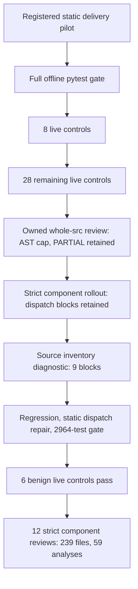

# Static dispatch iteration and component rollout — 2026-10-02

The local defensive static delivery flow was validated, repaired after a demonstrated dispatch defect, and expanded to the complete owned `src` inventory under fixed component budgets. This is not an E1–E5 attack-scenario/witness run or a whole-application safety assessment.

## Repair and live acceptance

The v2 guard counted every AST call on the selected line. A sole `eval(compile(...))` or `subprocess.run([str(item)])` was therefore rejected before its static validator ran. The repaired guard inventories distinct registered operations using discovery's syntax and alias rules. The original complete slice still reaches the original validator; unknown values, bindings and side effects do not become proof. Multiple registered operations on one line remain blocked. Default v1 and execution-witness code were not changed.

The first ten public CLI regressions produced **4 failed / 6 passed** before repair. They covered benign nested arguments, multiple true operations, and strong literal-mode positive controls. The first combined post-repair run passed 22 checks. Two further module/import alias controls brought the dispatch regression set to **12 passed**. Full in-process admission then passed **2964 tests in 431.69 seconds**, before credentials were read.

Six new tools-disabled live controls completed through the original gated adapter: **6 requests / 8,214 reported tokens**, within the frozen 6-request / 30,000-token budget. Output was SUPPORTED, REFUTED, and four UNKNOWN results. All candidates, references and states matched the original observations; original packages and complete copies remained unchanged and reverified. Replies and usage were retained before interpretation. Model replies did not alter canonical property states.

The preceding engine's eight-plus-28 delivery experiment separately completed **36 requests / 42,322 reported tokens** after its 2952-test gate. It remains a separate protocol and source snapshot. This user-authorized iteration used **42 requests / 50,536 reported tokens** across the two versions, within their combined 42-request / 150,000-token caps. Their successes are not pooled as an unchanged-protocol or causal model-quality result. Provider monetary cost was not reported.

## Complete owned source coverage

The original monolithic run hit the unchanged **200,000 AST-node cap** and produced a PARTIAL package: 206 files read, 47 candidates, and incomplete inventory. That failed rollout is preserved. A subsequent strict component run stopped when two baseline candidates were blocked; the separately registered diagnostic then inventoried all 239 source files and identified nine dispatch blocks across baselines and evaluation. Neither PARTIAL run was changed into a pass.

After repair and the new gate/live acceptance, the same twelve-component strict policy completed. Current source totals are **239 files, 1,837,775 bytes, and 281,525 AST nodes**. Each frozen path and byte hash occurs in exactly one component; no source drift, omitted file or duplicated membership was observed. Every private package and complete copy verified with the new engine.

| Component | Files | Candidates | Blocks before | Blocks after |
| --- | ---: | ---: | ---: | ---: |
| Root files | 3 | 1 | 0 | 0 |
| agents | 12 | 1 | 0 | 0 |
| application | 15 | 3 | 0 | 0 |
| baselines | 14 | 2 | 2 | 0 |
| code_adapters | 11 | 0 | 0 | 0 |
| domain | 8 | 3 | 0 | 0 |
| evaluation | 107 | 34 | 7 | 0 |
| harness | 7 | 0 | 0 | 0 |
| presentation | 3 | 0 | 0 | 0 |
| retrieval | 6 | 0 | 0 | 0 |
| runtime | 27 | 13 | 0 | 0 |
| tools | 26 | 2 | 0 | 0 |
| Total | **239** | **59** | **9** | **0** |

All **59 candidate analyses completed** with zero blocked or failed analyses; all **59 property states remain UNKNOWN**. The nine repaired cases have identical source-byte hashes, candidate IDs and operation locators before and after; they now receive an actual static attempt, not a fabricated strong conclusion. Their exact comparisons are in the [final receipt](final-result.json). The literal-mode SUPPORTED/REFUTED controls remain valid, so this is not a blanket UNKNOWN implementation.

## Scope and reproducibility

- [Frozen live protocol](protocol.json), [live runner](run.py), [raw-reply reconciliation](analyze.py), and [live acceptance](result.json).
- [Frozen component policy](component-protocol.json), [component runner](run_components.py), [component receipt](component-result.json), and [final reconciliation program](finalize.py).
- [Final sealed receipt](final-result.json) binds the gates, versioned request ledgers, source inventory, package/copy hashes and preserved failures. The current component run is `artifacts/component_dispatch_repair_20261002/917faf2932f848c58a1b35d281e86fb0`.
- Components have separate admitted source contexts. Their coverage is not a combined cross-component proof. The monolithic cap remains unchanged; one-pass whole-src readiness is not claimed.
- All project-src expansion runs used zero model calls and zero target-source executions. Their source-pattern candidates are review leads, not confirmed vulnerabilities. The six live repair controls are owned development inputs, not independent or held-out evaluation.
- The 14 named-mode limitations in the earlier 36-control corpus remain. Independent real-project quality, human effort and model net benefit were not measured. Production R17, scratch/native execution, original G-A and the attack/witness E matrix were not enabled. Historical release ZIPs remain unchanged; this repair is in the shared workspace.
