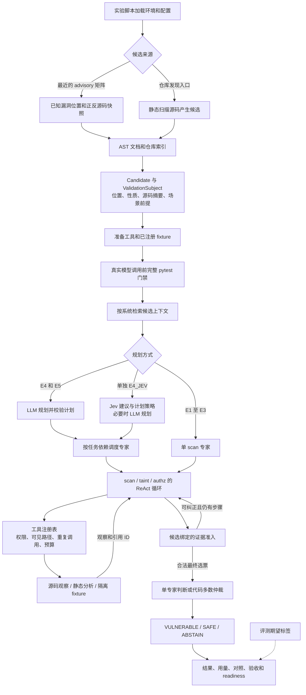
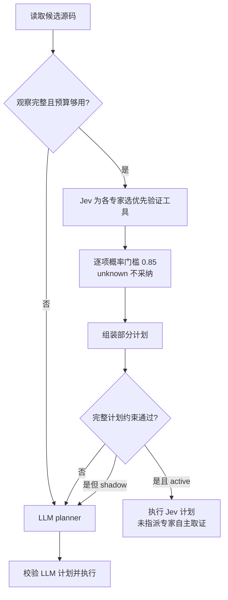
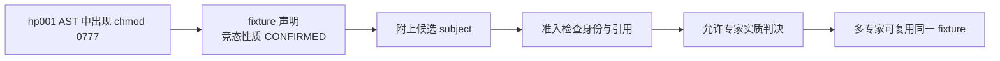
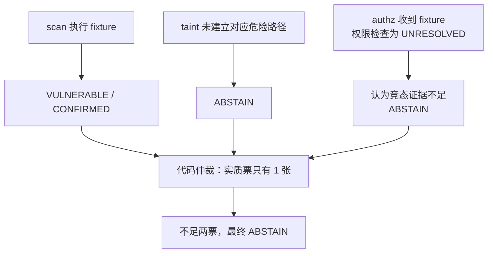

# 当前项目流程与问题定位

核对日期：2026-09-27。依据为当前源码，以及完整矩阵 `9f59cdbd664b48fdb03175159c5fe4fb` 和 Jev active 对照 `6b16f651a0904ca194f1af29c86b7366`。本文件描述当前实现，不把设计目标当作已验证能力。

主系统是“给定候选位置和待验证性质后，用工具获取证据，再由模型生成受代码约束的判决”。仓库候选发现是另一条已有入口；最近的 30-cell 不经过自动发现，也没有使用 Jev。

## 1. 整体数据流



图中期望标签的合理职责是末端评分。当前 hp003 fixture 内部仍使用 revision_role 过滤结果，是后文单列的验证边界问题。

主要调用链：

```text
scripts/heldout_matrix.sh
  -> evaluation.runners.run_python_heldout_pair_matrix.run
  -> evaluation.datasets.composition.load_advisory_config
  -> evaluation.lifecycle.run_advisory_experiment
       -> advisory_tasks.build_task_plan
       -> runtime.admission.require_passing_tests
       -> runtime.provider.load_experiment_model
       -> evaluation.execution.run_candidate
            -> agents.workflow.AgenticPipeline.run
                 retrieve -> plan -> 专家任务循环 -> adjudicate
       -> results / usage / acceptance / readiness
```

仓库发现入口使用 `agents.discovery.discover_python_repository` 和 `agents.scanner.StaticScanner` 产生候选，再调用同一审查核心。最近矩阵的候选由文件和行号选择，不能测量自动发现的召回率。

## 2. 各层的职责

| 层 | 输入与输出 | 当前职责和边界 | 主要代码 |
| --- | --- | --- | --- |
| 配置与提供商 | 环境文件、dataset、profile → 运行配置 | `.env.experiments` 由 shell 加载；provider 决定 DeepSeek 或 Gemini 代理；Python module 不隐式加载环境文件 | `runtime/provider.py`、`evaluation/datasets/composition.py` |
| 数据和候选 | checkout、指定位置/扫描结果 → Candidate | advisory 指定漏洞类型、位置及场景；不等于扫描器发现了漏洞 | `advisory_source.py`、`agents/discovery.py` |
| 身份绑定 | Candidate + 索引 → ValidationSubject | 绑定仓库、源码摘要、位置、property_id、输入与环境前提，防止串用其他候选证明 | `tools/identity.py`、`domain/evidence.py` |
| 检索 | 索引 + Candidate → 有限上下文与 admitted paths | local / text / graph；工具可读已准入文档的完整内容，但不能任意扩张普通源码工具的访问路径 | `retrieval/index.py`、`agents/workflow.py` |
| 规划 | 上下文 + 工具能力 → 子任务依赖图 | 指定专家、验证器、依赖；有命令、权限和 fixture 依赖的固定规则 | `agents/planning.py` |
| Jev | 源码 + 各专家工具选项 → 概率与选择 | 选择取证动作，不产生安全结论或额外选票；当前独立运行，只支持 E4 规则 | `agents/routing.py`、`runtime/jev.py` |
| 专家执行 | 子任务及依赖观察 → 工具轨迹与提议判决 | DeepSeek/Gemini 的不同角色；同一专家多个任务只留下一个累计最终选票 | `agents/workflow.py`、`agents/react.py` |
| 工具与验证 | 受限调用 → ToolObservation | 源码事实、静态状态、局部动态见证、注册 fixture 是不同类型的证据 | `tools/repository.py`、`tools/analysis/`、`tools/validation/` |
| 证据准入 | 选票 + 观察 + Subject → 接受、纠正或弃权 | 引用有效性、必需工具完成、性质/范围匹配、矛盾证据 | `agents/evidence_policy.py` |
| 仲裁 | 每专家一个最终票 → 最终标签 | 确定性 Python 代码，不再调用裁判 LLM | `agents/voting.py` |
| 运行治理 | API 和工具事件 → 日志、预算、结果 | 全量 pytest 门禁、源码指纹、逐请求记账、隔离、失败保留 | `runtime/`、`evaluation/` |

历史 `baselines/` 是另一套确定性基线；早期 V 系列不能混同当前 E1–E5。数据准备、Java/OWASP、模板复现等 runner 复用部分基础设施，但协议和证明范围独立。

## 3. E1–E5 实际区别

| 系统 | 检索 | 规划 | 专家 | 收尾 |
| --- | --- | --- | --- | --- |
| E1 | local | 无独立 planner | scan | 一张合格票决定 |
| E2 | 文本检索 | 无独立 planner | scan | 一张合格票决定 |
| E3 | 调用图检索 | 无独立 planner | scan | 一张合格票决定 |
| E4 | 调用图检索 | LLM planner | scan、taint、authz | 完整审查后至少两张同向实质票 |
| E5 | 调用图检索 | LLM planner | 同 E4 | 前两专家形成同向实质票时尝试早停，否则继续 |
| E4_JEV | 调用图检索 | Jev 优先；按 mode 和策略决定是否 LLM 兜底 | 同 E4 | 同 E4 |

专家是同一模型提供商上的不同角色、工具权限和任务提示，不保证是独立模型或独立证据来源。

`_next_task` 还会调度没有被 planner 分配任务的固定专家。因此 planner 没给 authz 安排子任务，并不代表 authz 被跳过。E5 早停可以避免第三位专家运行；E4 通常不会。

在无独立规划的 scan 路径中，如果存在匹配的注册 fixture，代码会把 run_fixture_test 设为首要必需工具。开发矩阵里 E1/E2/E3 的高正确率，并不单独证明其检索已找全漏洞链路。

## 4. 三种成功状态

| 状态 | 实际含义 | 不能自动推导什么 |
| --- | --- | --- |
| 工具 `status=ok` / `validator_completed=true` | 工具完整完成并投递观察 | 不等于证明漏洞或安全；可以返回 UNRESOLVED |
| `CONFIRMED / REFUTED / UNRESOLVED` | 验证器对自己声明的证明范围给出的状态 | 只有范围和性质确实成立时，才能用于候选判决 |
| `VULNERABLE / SAFE / ABSTAIN` | 专家或系统对候选声明性质的预测 | 不等于完整应用 exploit 复现；多票也不产生额外事实 |

普通静态 MAY_REACH 提供路径线索。候选绑定的完整命令分析可以在声明范围内支持 VULNERABLE/SAFE，同时保留验证状态 UNRESOLVED。工具名称和状态字样不能代替实际证明契约。

准入会拦截未知引用、未完成的必需验证、范围不匹配、与已有充分证据相反的实质判断。ABSTAIN 可以在合规取证后保留；代码不会强迫专家按另一位专家的标签投票。

## 5. Jev 当前流程与阻塞



hp003 active 的源码预算最初为 4096，两个候选被截断，Jev 请求为零。显式改为 6144 后两次请求成功；额度仍从 8192 总规划观察预算扣除。

两次回答中 scan 选择 inspect_command_construction，概率 0.94/0.95，获准；taint 选择 trace_dataflow，概率 0.51，未获准；authz 为 unknown。没有 fixture 任务的命令计划要求 scan 和 taint 都安排 inspect_command_construction，故部分计划校验失败，两个 cell 的选择全部 applied=false，进入 LLM planner。

设计错位在于：Jev 回答“各专家先做哪个检查”，下游却把答案直接当作“满足全部强制任务和依赖的完整计划”验收。Jev 提示没有完整表达 planner 的组合约束；单个高概率选择不足以构成合法整体。

fixture 计划有另一条合法规则：先运行注册 fixture，其他已计划任务都依赖其结果；有 fixture 时，不再强制 scan/taint 分别重复命令检查。LLM 在本次兜底中采用了这条规则，两条计划仍经过同一校验函数。

active 对照四项正确，但 Jev 组 49 请求、390514 tokens，对照 E4 为 45 请求、347400 tokens，双方 LLM planner 均 6 请求。没有观察到规划节省。

## 6. 优先审查：fixture 证明范围与准入信任

深入审查后，需要修正此前仅把 hp001 弃权归为“专家没有利用证据”的说法。下面是代码真正做的检查。

| Fixture | 实际检查 | 当前声明 | 缺口 |
| --- | --- | --- | --- |
| hp001 | 遍历函数 AST，寻找 mkdtemp、清理调用和对 tmp_dir 的字面 chmod，判断 others-write 位 | temporary-directory-race 的 CONFIRMED/REFUTED | 没有执行函数或竞态；未证明攻击者动作、后续敏感消费、控制流和跨调用副作用。权限位结构事实被提升为更宽的竞态性质 |
| hp002 | 对 route/service 的 AST 文本检查 lookup/delete/owner guard/current_user 传递字符串 | authorization-boundary 的 CONFIRMED/REFUTED | 没有 HTTP/数据库双用户实验，也未在此实现里证明 guard 控制实际删除路径；字符串存在不等于有效强制检查 |
| hp003 | 执行真实 mlserver.get_cmd，再用受控 bash 和参数记录 stub 观察固定 payload；backend 采用形状检查 | command-execution 的 CONFIRMED/REFUTED | 不执行完整 serve/download 链；固定载荷字面保留不足以单独证明所有输入安全；结果还依赖 expected_role |

代码定位：

- [advisory_fixtures.py](../../src/cv_agent/evaluation/datasets/advisory_fixtures.py)：三个 `_run_hp00*_fixture` 实现。
- [fixtures.py](../../src/cv_agent/tools/validation/fixtures.py)：将 outcome 直接封装为携带 subject 的 ToolObservation。
- [evidence_policy.py](../../src/cv_agent/agents/evidence_policy.py)：按 subject 和 typed status 接纳注册 fixture，不重新证明 runner 内部语义。



身份绑定解决“哪个候选、哪份源码”，不会自动解决“该检查证明了什么”。隔离执行和源码哈希不会把 AST 模式检查升级为动态漏洞见证。静态证明本身可以有效，但必须覆盖声明的性质和路径；当前 hp001/hp002 实现没有完整的这类证明。

hp003 的 expected_role 来自评测 vulnerable/fixed：只有“预期 vulnerable 且观察到展开”才 CONFIRMED，只有“预期 fixed 且观察到字面保留”才 REFUTED；相反观察返回 UNRESOLVED。模型提示虽未直接接收该标签，验证器输出仍被预期角色过滤。通用验证器应按实际行为输出，预期标签留给末端评分。

这些是代码审查发现的证明契约缺口。本次没有新增动态反例逐个验证，也没有改写验证状态或历史结果。但不能仅凭登记的 CONFIRMED，就认定 authz 对竞态证据的谨慎一定是偷懒。

## 7. 最新弃权发生在哪里

最新唯一弃权为 hp001_a/E5：



原始请求显示 authz 能看到 scan/tool:1 和 fixture 完整结果，所以不是依赖证据未投递；它未使用该 fixture 支持实质判断。基线同 cell 的 authz 使用 fixture 后投 VULNERABLE。

已确认的是“模型对证据的采用不同，导致票数不足”；尚不能确认“新的弃权一定错误”。必须先解决 fixture 的证明范围，再判断专家是否遗漏充分证据。多数仲裁按现有规则工作，降低票数门槛不能修复上游证明问题。

## 8. 固定专家与 ReAct 开销

scan、taint、authz 是固定名单，未明确安排的专家仍会运行。命令候选的 authz 通常没有独立支持命令性质的检查；没有明显外部数据源的目录权限问题常不适合 taint 路径分析。只有一两个适用检查时，系统仍可能执行三个角色。

同一模型、同一 fixture、不同角色产生两张票，不等于两份独立安全证据。票数可检查解释一致性，不能增加底层事实的证明强度。

ReAct 会为计划/选票 JSON、引用和证据规则的拒绝追加纠正请求。最新 E4 日志已有 hp001_b 的 hypothesis 长度超限和缺少强制 authz 权限任务、hp002_b 缺少 fixture 依赖。这些额外请求在生成本可由代码确定的计划结构。

| 预算 | 当前含义 |
| --- | --- |
| 检索基础上下文 | 4096；增强检索另有 12288 额度，top_k=12，图深度 4 |
| 工具观察 | planner/每位专家总额度 8192；同一专家的多个任务分摊并累积 |
| Jev 源码 | 默认 4096，hp003 active 为 6144；active 后续 planner 使用剩余额度 |
| ReAct 步数 | 每次任务循环最多 8 次模型步骤，末尾留出收尾步骤 |
| 当前全矩阵 | 900 请求、14400 秒准入窗口，并发 2 |

上下文和工具预算主要按序列化文本的 UTF-8 字节上界计量，与 provider 上报 tokens 不同。系统提示、工具 schema、多轮历史也消耗真实 API tokens，不能把 8192 乘专家数当成整轮成本。

工具预算耗尽后下一次模型步骤进入 finalization；但一个回复可能包含多个 tool_calls，这一批后续调用仍逐项记录为 blocked/error。“耗尽后还有调用”不必然是模型看完诊断后又请求一轮，须按 request_id/step 区分。

## 9. 实验能说明什么

30-cell 是 **3 个漏洞/修复对、6 个源码快照、5 种系统设置**，不是 30 个独立漏洞；来自 MLflow、Langflow 两个项目。位置和待验证性质预先给定，30 个 cell 都取得了注册 fixture 状态。

fixture 可读取注册 checkout 的指定源码并运行预制步骤，与普通检索后受 admitted_paths 限制的源码工具不是同一种取证通道。它可能主导结果，削弱 E1/E2/E3 检索差异的可解释性。

最新结果：29 正确、1 弃权、0 误判、0 执行失败，283 请求、2,008,214 reported tokens。基线：30 正确、292 请求、2,084,142 tokens。E5 四项早停，E4 请求反而 117→136。代码和 subject 前提也变化了，不能把单轮用量差异全部归因于某个优化。

acceptance 同时包含质量和完整性检查；readiness 还检查用量、实验角色和 fixture 依赖。1828 项离线测试通过表示既有断言通过，不证明 fixture 性质定义正确，也不恢复开发样本的独立评测资格。

## 10. 调整顺序与验收

| 优先级 | 环节 | 应先做什么 | 怎样确认解决 |
| --- | --- | --- | --- |
| 第一 | 证明范围和 fixture 信任 | 核对声明性质、实际观察、路径和前提；hp001/hp002 补行为/控制流证明或限定证明范围；hp003 去掉 expected_role 对验证状态的影响 | 反例覆盖死分支、失效 guard、相反预期标签、局部安全但整体未覆盖；不能证明时保留 UNRESOLVED |
| 第二 | 计划组合 | 确定性规则组成必需验证及依赖；Jev 决定可选部分，LLM 处理真正不确定部分 | 已接纳选择实际 applied，必需验证齐全，LLM 请求减少，证据门槛保持成立 |
| 第三 | 专家适用性和证据消费 | 按候选性质选择适用检查，显式记录未采纳有效证据的原因 | 无关调用减少，充分证据解释更一致；新调度协议单独报告，不偷换 E4/E5 基线 |
| 第四 | 预算与循环 | 按 trace 定位截断、重复读取、同批无效调用、纯格式纠正 | 比较 request_id、有效观察率、截断率、reported tokens，不只增加预算 |
| 第五 | 评测 | 分别运行有 fixture 的开发回归和无 case 专用证明的新样本评测 | 冻结协议、保留重复运行，分别报告发现能力、判决质量、弃权、失败和用量 |

主循环、传输和仲裁已经能运行；当前最应先审的是“证据到底证明了什么”，其次是让 Jev 和专家以更少请求使用这些证据。压低弃权率本身不能作为正确性目标。
